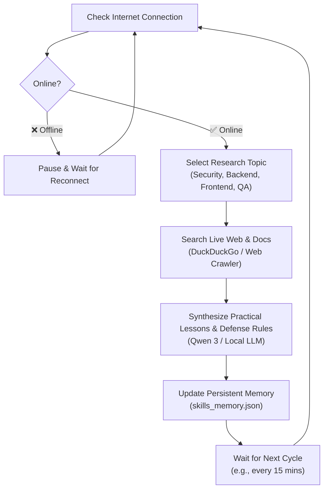

# 🌐 Continuous Autonomous Web Learning Skill

This engine enables local LLMs to continuously self-educate and expand their skills whenever an active internet connection is detected.

---

## 🧠 How It Operates



---

## 📚 Core Topics Self-Studied
- **🛡️ Cybersecurity**: OWASP Top 10 vulnerabilities, secure auth patterns, SQLi & XSS prevention.
- **⚙️ Backend Coding**: High-performance Python, FastAPI, API architecture, clean code principles.
- **🎨 Frontend & UI/UX**: Modern CSS, responsive layouts, glassmorphism, DOM manipulation.
- **🧪 QA & Testing**: Automated test strategies, PyTest mocking, regression prevention.

---

## 🚀 How to Run

### 1. Run Continuous 24/7 Background Learning Loop:
```powershell
python c:\Users\cool\Desktop\skills\autonomous_web_learner.py --interval 15
```

### 2. Run a Single Instant Learning Session:
```powershell
python c:\Users\cool\Desktop\skills\autonomous_web_learner.py --once
```

### 3. Check What the Model Learned Today:
```powershell
python c:\Users\cool\Desktop\skills\skill_evolver.py
```
